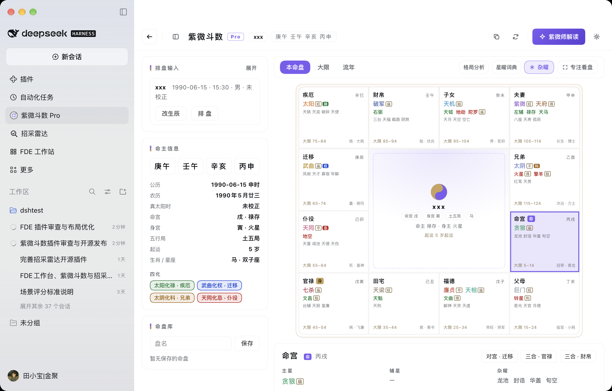
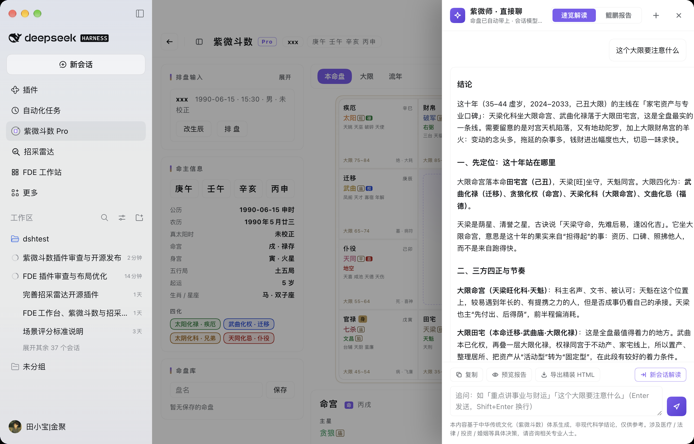
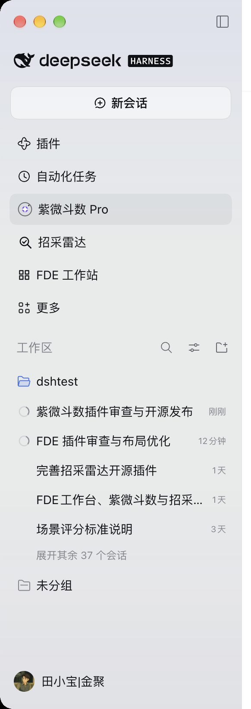

# 紫微斗数工作台 · Zi Wei Dou Shu Workbench

> 一个 DSH（DeepSeek Harness）插件：**确定性紫微斗数排盘** + **面板内直接解读**。
> 前面看盘，后面直接聊。排盘走独立引擎，解读走 Harness 会话模型。

[](https://github.com/NeoJubao/dsh-ziwei/actions/workflows/ci.yml)

[](https://www.npmjs.com/package/dsh-ziwei)

[](https://github.com/NeoJubao/dsh-ziwei)


**English summary:** A single-package plugin for DeepSeek Harness that computes Zi Wei
Dou Shu (Purple Star Astrology) charts deterministically from raw birth data
(date / clock time / gender / birth-place longitude, with true-solar-time correction)
and renders a 12-palace workbench inside the DSH web UI. It exposes four host tools
(`ziwei_paipan`, `ziwei_check`, `ziwei_templates`, `ziwei_context`) and an SSE route that
streams interpretations through the user's own configured model provider — no API key is
stored in the browser. Licensed MIT; third-party notices in
[THIRD_PARTY_NOTICES.md](THIRD_PARTY_NOTICES.md). This is a community plugin, not an
official DeepSeek product.

---

## 界面预览

真实 DSH 宿主截图（macOS，浅色主题，1280×820 窗口 @2x）。

**本命盘工作台**：确定性排盘 + 左栏命主信息 / 命盘库，右侧十二宫与宫位详情。



**紫微师 · 直接聊**：命盘自动带入，用已配置的模型回答；示例问「这个大限要注意什么」。



**侧栏入口**（DSH 左侧栏中的「紫微斗数 Pro」）：



> 深色主题与四档宽度的渲染预览见 [docs/design/assets/](docs/design/assets/)；
> 截图规范见 [docs/assets/README.md](docs/assets/README.md)。

## 功能

- **手动检查更新**：设置弹层显示当前版本与「检查更新」；只在点击时经 Host 路由请求 npm registry
  一次，不后台轮询、不记录生辰数据。
- **四柱月柱默认按节气**（八字通行口径），可在「排盘设置 → 月柱」切回「农历月」；
  命宫、星曜、四化与十二宫始终按农历月计算，不受该设置影响。
- **排盘只有一个来源**：工作台引擎（`src/engine-core.js` → `engine-built.js`）是
  **独立实现**，结果与来源产品逐字段对齐验证（20 个跨世纪 / 立春 / 早晚子时 /
  极端经度 / 男女用例）。排盘只接原始四要素（日期 / 钟表时间 / 性别 / 出生地经度），
  真太阳时校正与时辰索引全在内部完成，**严禁手工排盘**。
- **4 个 agent 工具 + 一段系统提示词**：`ziwei_paipan`（确定性排盘）、`ziwei_check`
  （黄金用例四断言自检）、`ziwei_templates`（紫微师方法论：人设 / 九诀 / 鲲鹏 14 部分 /
  红线 / 交付前自检）、`ziwei_context`（读取面板最近一次交接的盘）。提示词把铁律写进每个
  会话：工具失败必须停手、缺参先追问、报告文末必附免责声明。
- **面板内直接聊**：解读从「一次性输出」升级为多轮对话。走 Host 的 `/ziwei/interpret`
  SSE 通道与 Harness `llm` 服务，**不需要在浏览器里另配 API Key**。速览解读
  （800–1200 字）与鲲鹏报告（完整 14 部分 + 致命主书 + 十二字心法）两种模式。
- **流式收尾有明确语义**：只有收到 `done` 才算写完；命中 `max-tokens`、整体超时、
  连接中断都会保留已生成部分并给「继续生成」，不会再把半截正文当完整结果。
- **界面 v2 / v2.1**：盘面优先的自适应布局（ResizeObserver 实测面板宽度分三档）、
  宫格字号随盘宽缩放、出盘自动收起生辰表单、「专注看盘」；解读改为面板内右侧阅读抽屉，
  设置改为面板内弹层，顶栏按钮分层。
- **「新会话解读」**：一键用 Host `sessionController` 真开新会话，把命盘与已有解读
  灌成首条消息，长报告交给会话 / 子代理跑。
- **隐私**：生辰与命盘只在本地浏览器 / 本机 Host 路由 / 你配置的模型 provider 之间流转；
  浏览器 localStorage 只存偏好与命盘库，**不存 API Key**（旧版遗留键会在启动时清理）。

## 安装

三种方式（本地 link / `plugin_manager install_bundle` 绝对目录或 tarball / npm + 插件索引）
和排障都在 **[docs/INSTALL.md](docs/INSTALL.md)**。最短路径：

```bash
# 从 npm 安装（推荐给普通用户）
dash plugin --profile <profile> add dsh-ziwei@1.3.1

# 开发者：把本地插件目录装进一个 profile（也可在 DSH Web Plugins 页添加）
dash plugin --profile <profile> add "/绝对路径/到/ziwei-workbench"
```

> **更新**：`dsh plugin --profile <profile> update dsh-ziwei`（或 `add dsh-ziwei@<version>`）；
> 插件不会自动更新，也不会后台检查更新。

> **Host 半（工具 / 提示词 / 路由）装完或更新后必须手动重启 DSH**；只改浏览器半
> （面板 UI）刷新页面即可。插件不会自己重启 DSH。
>
> **仓库内包名是 `@local/ziwei-workbench`（`private: true`）**，这是本机 `link:` 安装的
> 前提。对外发布名由 `scripts/release-pack.mjs` 在 `dist/` 副本里改写（见
> [docs/PUBLISHING.md](docs/PUBLISHING.md)），仓库里的名字不会被改。
>
> **构建前置**：改 `src/` 后先 `node build.mjs`；`npm pack` 之前也必须先构建，
> 否则打进去的是旧产物。构建所需数据表已 vendored 进仓库（`src/lunar-data.js`），
> 干净 clone 上不依赖任何外部目录。

## 兼容性

| 项 | 范围 / 验证情况 |
| --- | --- |
| DSH | `engines.dsh`：`>=0.2.1-rc.5 <0.3.0`（以 `package.json` 当前值为准）；**开发与验证基线 0.2.1-rc.5** |
| Node.js | `>= 22`（CI 覆盖 22 / 24；本机验证用 Node 24） |
| 平台 | Web 前端（macOS / Windows / Linux 的 DSH 桌面端共用同一套 Web UI）；CI 跑三平台 |
| DSH 稳定性 | DSH 是 **developer preview**，会有破坏性变更；本插件声明的是**声明式**兼容范围，升级后请跑一遍验证 |

> 兼容性判断只看 `engines.dsh`（DSH 0.2.1-alpha.3 起，有该字段时不再看
> `@deepseek-ai/dsh*` 的 peer 范围）。0.2.x 之外的版本未验证。

## 架构

Host 半 / Client 半 / 构建链 / 三条数据流 / 依赖边界 / 自检地图，见
**[docs/ARCHITECTURE.md](docs/ARCHITECTURE.md)**。一句话版本：

```text
index.js（Host：4 工具 + 系统提示词 + 4 条路由 + vm 沙箱加载引擎）
        ↕ 同源 fetch（SSE / JSON）
client.js（浏览器：懒加载内核 + 排盘引擎 + 紫微师内核 + React 面板）
```

关键约束：插件以 `link:` 装进 profile，运行时**不能 import `@deepseek-ai/*` 包**；
Host 半必需注入只有 `tools` / `systemPrompt`，`webServer` / `llm` 走 `ctx.inject`
按需等待，其余服务一律 `ctx.get(...)` 取（缺失时降级）。

## 验证

```bash
# 全量自检：8 组（内核与 host / 导出 / 路由 / 工具 / 差分 / SSE / 打包 / 界面契约）
node build.mjs
node verify/all.mjs

# npm 包内容自检（运行时必需文件是否都在包里、日志是否意外打包）
node verify/pack.mjs
```

| 组 | 脚本 | 查什么 |
| --- | --- | --- |
| 1 | `verify/verify.mjs` | 引擎契约、黄金用例四断言、host 注册与执行、客户端 bundle 可求值、**构建产物新鲜度**、面板默认口径、darwin chrome 避让与「返回会话」出口 |
| 2 | `verify/exports.mjs` | 宿主入口导出契约（`name` / `inject` / `apply`）；确认 `webServer`/`llm` 走后 `ctx.inject` 而不是硬依赖 |
| 3 | `verify/routes-auth.mjs` | 路由方法白名单、`requestRejection`、owner-only Peer、JSON Content-Type 守卫 |
| 4 | `verify/verify-tools.mjs` | 用**真实** `dsh-tools` 运行时校验 4 个工具真的注册、schema 合法、缺参拒绝 |
| 5 | `verify/diff-runner.mjs` | 20 个用例逐字段差分。**两种模式**：有来源产品 runner 时用 runner；没有时用随仓库提交的 fixture（`verify/fixtures/paipan-reference.json`） |
| 6 | `verify/sse-hang.mjs` | SSE 对无视 abort 的挂起流必须超时解锁、`max-tokens` 不得伪装成 `done`、断连语义 |
| 7 | `verify/pack.mjs` | `npm pack --dry-run` 打包完整性（`engine-built.js` / `src/ziwei-core.js` 等必需文件、日志不进包） |
| 8 | `verify/ui-contract.mjs` | 界面契约的可机械化检查（区域 / token / 可访问性），包装 `scripts/audit-ui.mjs` |

退出码约定：

| 退出码 | 含义 |
| --- | --- |
| 0 | 全部断言通过 |
| 1 | 有断言失败，**或**环境依赖缺失（例如真实 `dsh-tools` 不在、runner 与 fixture 都缺失）。环境缺失默认算失败，避免「一致性保证」无声消失 |
| 3 | 子脚本被**显式跳过**（仅在 `ZIWEI_ALLOW_SKIP=1` 时）。`all.mjs` 标 ⚠️「已跳过，未验证」，不标绿、不算通过 |

> **差分测试说明**：仓库随附 `verify/fixtures/paipan-reference.json`（某次从来源产品
> runner 捕获的 20 用例期望输出），所以公开 CI **不需要**来源产品也能守住逐字段一致。
> 维护者本机有 runner（`ZIWEI_RUNNER` 可指定）时会自动优先用 runner；重捕 fixture 用
> `node verify/diff-runner.mjs --write-fixture`。
>
> `verify-tools.mjs` 需要本机安装的 DSH（真实 `dsh-tools`）。在没有 DSH 的机器/CI 上，
> 用 `ZIWEI_ALLOW_SKIP=1` 会让它按退出码 3 跳过并明确标记「已跳过，未验证」。

## 排盘口径（与来源产品对齐）

- **晚子时（校正后 23:00–23:59）按当日不换日**（`dayDivide: 'current'`），与来源产品
  runner 一致。工作台早期默认「按次日」，同一生辰会排出两张不同的盘——约 1/13 的出生
  时间落在 23 点段，所以这个默认值很关键。面板里仍可手动切「按次日」；会话里的
  `ziwei_paipan` 也接受 `dayDivide: 'forward'`。
- **主星庙旺表已逐格对齐**（曾有三格不同：太阳 / 太阴 / 七杀在酉）。
- 时辰索引：工作台把晚子时记为 `12`、早子时记为 `0`（来源产品两者都是 `0`）。
  `dayDivide=current` 下两者排出的盘完全相同，只是索引表示不同。
- **时辰标签**：面板与 `ziwei_paipan` 区分「早子时 / 晚子时」，来源产品一律显示「子时」。
  命盘相同、标签更精确；两边对照时会看到这个差异。
- 差分的一行归一化只作用于「时辰索引」这一项；十二宫主星/庙旺/辅星/杂曜/四化、五行局、
  命宫身宫、命主身主、农历、干支、生肖都是**独立逐字段比对**，安星日一错必然暴露
  （把口径退回换日派会立刻报 16/20）。

## 踩过的坑（改代码前先看）

1. **插件不能 `import '@deepseek-ai/*'`。** 它是以 `link:` 装进 profile 的，运行时解析不到
   那些包。所有服务一律 `ctx.get(...)` 取；工具定义手工构造 `ToolDefinition`，消息也按
   契约手工组装。
2. **`output.schema.type` 只能用 `object/array/string/number/integer/boolean/null`——没有 `json`。**
   `tools.register()` 会调 `assertSupportedJsonSchema`，非法直接抛错；而外层 `try/catch`
   只打一行 warn，**表现是工具静默全部不注册**。
   （`{type:json}` 是 `defineTool` DSL 的写法，手工构造时不能这么写。）
   防回归：`verify-tools.mjs` 用真实 `dsh-tools` 校验器把关。
3. **手工构造 `ToolDefinition` 会绕过 `defineTool` 的参数校验。** 声明的 `required` 形同虚设，
   所以插件必须自己校验入参。最危险的是 `gender`：缺失时静默按男命排盘会让女性用户的
   **十二宫大限整体反向**。现在 `gender` 缺失或非法一律拒绝排盘。
4. **缺出生时间同样拒绝排盘**，不默认取 0 点——否则会静默算出一个错误的命盘。
5. **`sessionController` 是进程级共享的**，不是每会话一份——`ziwei_context` 读到的是最近
   一次交接的盘。
6. **`/ziwei/interpret` 的预算、超时与「截断」语义**（2026-10-19 修）：
   - **输出预算**：brief 8192 / report 32768，再按模型 `defaultMaxTokens` 封顶。
     旧版 brief 钉死 `maxTokens=2048`：适配器默认开 thinking，思考 token 与正文共用同一份
     `max_tokens`，正文写到一半就撞 `max-tokens`——这正是「输出一半就中断」的根因。
   - **结束原因必须逐个判**：`stop` → `done`；`max-tokens` → `event: error`
     （`kind:"max-tokens"`、`canContinue:true`、保留前文）；流结束却没给 `finish` 帧 →
     `kind:"stream-closed"`。旧版只认 `error`/`aborted`，`max-tokens` 落进 `done` 分支，
     面板于是把半截正文当完整结果保存下来。
   - **通道先建**：请求一开始就发 `start` 帧并 flush，思考阶段几十秒没有 delta 也有
     `: ping` 心跳（15s）；`reasoning-delta` 会节流转成 `thinking` 事件。
   - **整体超时**：brief 240s / report 600s；超时必须与 `iterator.next()` 做**竞态**
     （`Promise.race`），只检查 `signal.aborted` 是不够的——上游若不响应 abort，`await`
     会永远挂着，超时分支和 `finally` 都不会执行，面板就永久停在「解读中」。
   - **收尾顺序**：必须先 `res.end()`，再 fire-and-forget 关掉迭代器。若写成
     `await iterator.return()`，它会排队在那个被 `Promise.race` 丢弃、永不 settle 的
     `next()` 之后，于是 `res.end()` 永不执行、连接泄漏（`sse-hang.mjs` 里有真实
     async generator 用例专门盯这个）。
   - **客户端判定**：只有收到 `event: done` 才算写完；`done` 带全文，以它为准。读完流却
     没见过 `done`/`error` → 显示「连接中断，内容可能不完整」。截断 / 超时 / 断连 /
     用户点「停止」都保留已生成部分，错误条上给「继续生成」按钮（把半截正文作为
     assistant 历史回传，追加「接着写、别重复」）。
   - **诊断**：每次解读往 `interpret-diag.log` 写一行（模型、档位、预算、结束原因、用时、
     token 用量），最多 512KB 后自动重写；`ZIWEI_DIAG=0` 关闭。复现「输出一半」时先看
     这一行，`finish=max-tokens` 与 `timedOut=true` 一眼可分。
7. **交接后的界面跳转是尽力而为**：新会话可能还没同步进客户端目录，所以 `openSession`
   会重试，始终失败会明确提示去侧栏打开，不会假装成功。
8. **客户端必须 lazy-CJS**：官方 `ui-plugin` 契约要求 module-body 副作用在 materialization
   时发生。`client.js` 加载期只注册 `__ModuleLoader__` factory，引擎在 UI factory 首次
   物化时才求值；否则加载即执行 226KB 引擎、提前写 `window` 全局。
9. **面板是主面板，不是弹窗**：浮层用面板内绝对定位（`.zp-root` 外壳 + 内部滚动层），
   不按视口坐标算位置；`isolation: isolate` 把内部 z-index 收进自身，避免盖住 frame 的
   `shell.leading`（macOS 折叠侧栏后的退出控件）。darwin 还要按
   `--dsh-frame-top-clearance` / `--dsh-frame-leading-clearance` / `--dsh-frame-overlay-top`
   避让窗口 chrome。

## 界面 v2 / v2.1（2026-10-30）

### 盘面优先的自适应布局（v2）

旧布局是 `330px 表单 + 1fr 盘面 + 300px 详情`，盘面是唯一可压缩列；旧响应式用
`@media (max-width:1100px)` 看的是**视口**而不是**面板**宽度，1200 视口时仍认为「很宽」，
盘面继续被压。改后：

1. 用 ResizeObserver 实测面板宽度分三档（阈值按「侧栏出现后盘面仍有 720px」反推）：
   - 窄（< 1072）：单列；出盘后盘面提到最前、收起的生辰条排到盘面之后；
   - 中（1072–1393）：296px 左栏 + 盘面全宽，宫位详情在盘面下方；
   - 宽（≥ 1394）：304px 左栏 + 盘面 + 300px 宫位详情右栏（sticky）。
2. 详情不再抢盘面宽度：窄/中档详情卡移入盘面下方，按 `auto-fit` 排成多列信息卡。
3. 宫格设为 CSS 容器（`container-type: inline-size`），宫名/主星/辅星/角标/中宫字号全部用
   `cqw` + `clamp()`，窄盘不挤字、宽盘不空。
4. 出盘后自动收起生辰表单（点「改生辰」展开）；「专注看盘」一键隐藏左栏与详情，
   盘面放大到 820px（没有盘时不会进入专注态）。
5. 视觉重做：金线外框 + 圆角宫格；中宫改为太极 + 命/身宫 · 五行局 · 生肖胶囊 + 起运；
   命/身角标、庙旺、四化角标统一规格；空宫显示「空宫」；顶栏 sticky 毛玻璃 + 四柱胶囊。
6. 修掉旧 token 拼写：`--dsw-alias-state-warning-primary` → `--dsw-alias-state-warn-primary`；
   颜色只走 `--dsw-alias-*`，星曜/四化等内容色集中成插件级 CSS 变量。
7. 兼容兜底：`cqw` / `color-mix()` 不支持时退回固定字号与 token 底色；
   `prefers-reduced-motion` 下关闭过渡。

### 解读改面板内阅读抽屉（v2.1）

旧「紫微师解读」是 `position:fixed` 的整窗弹窗（宽 880px、距顶 48px），按视口定位，
和工作台对不齐、窄窗口会压到左侧会话栏；按钮层级也混乱。改后：

1. 弹窗 → **面板内右侧阅读抽屉**：宽度 `min(464px, 100%)`、高度等于面板高，从右侧滑入；
   遮罩只盖工作台，窄面板下铺满全宽。面板拆成「不滚动外壳 `.zp-root` + 内部滚动层
   `.zp-scroll`」，抽屉/设置绝对定位在外壳内，不受祖先 transform、侧栏拖拽影响。
2. 设置改成面板内居中弹层，和抽屉共用 `.zp-overlay` 定位，Esc 可关。
3. 顶栏按钮分层：次级工具（复制 / 写入会话）→ 分隔线 → 主行动「紫微师解读」→ 设置。
   窄面板下次级按钮自动收成纯图标（悬停有 title）。
4. 抽屉内部重排：头部（标题 / 速览-报告切换 / 新对话 / 关闭）→ 对话区（自动滚到底）→
   底部工具条（复制 / 预览 / 导出 / 右侧「新会话解读」）→ 输入区 → 免责声明。
5. 两个动作改名区分：顶栏「写入会话」= 只把命盘写进当前会话上下文；抽屉「新会话解读」
   = 新建会话灌入命盘与解读。
6. 空对话给三条可直接点的示例（事业财运 / 大限注意 / 完整鲲鹏报告）；
   统一内联 SVG 图标（复制/同步/设置/关闭/发送/停止/预览/导出/交接/展开/杂曜）。

> **诚实说明：以上界面改动未做浏览器实机视觉复核。** 本仓库的自动化验证是静态断言与
> 假 DOM 可求值（`verify/verify.mjs` 会把 `client.js` 放进沙箱跑一遍），不能替代人眼。
> 改 UI 的 PR 必须附浅色/深色截图或录屏，见 [CONTRIBUTING.md](CONTRIBUTING.md)。

### 界面 v3：时间导航与结构分区（2026-11-08）

v2 的痛点是「把时间当成页面内容」：十二大限卡片列表和流年输入框都堆在盘面上方，盘面被挤下去；
左栏三张同规格卡片 + 盘面 + 详情最多出现 5–7 种卡型；时间选择还不进解读上下文。
v3 做两次分离：

1. **时间离开内容 → 常驻 TimeBar**：本命 / 大限 / 流年三个模式分段；大限用
   「‹ 段位 干支 宫位 › + 回到当前 + 下拉跳转」，流年用「‹ 年份 › + 今年」；
   默认停在**当前大限 / 今年**（旧版默认第 0 段 = 3–12 岁）。十二大限列表与
   年份输入条已退役，盘面不再被顶下去。
2. **工具离开主 tab**：格局分析、星曜词典不再占模式页签，改为 TimeBar 右侧工具入口，
   打开后占用工具页并提供「返回盘面」；模式页签固定 3 个。
3. **左栏可收起**：AppBar 加左栏开关（`aria-expanded` / `aria-controls`），窄屏出盘后自动收起，
   贴底行动条给「生辰 / 紫微师解读」；有盘后「排 盘」降为次按钮，HEAD 只保留一个主行动。
4. **四档宽度，侧栏展开也不拉满**：narrow（<908 单列）/ compact（908–1071，左栏 264 + 盘面 600）/
   mid（1072–1393）/ wide（≥1394，加详情 300）；全宽时左栏固定、盘面 ≤720，多出来的宽度只做对称留白；
   解读抽屉仍限宽 464，不会因为 DSH 侧栏折叠而铺满屏幕。
5. **深色可读性与细节**：白字填充改用专用 `--zp-fill-accent*`（深色白字对比度 2.72:1 → 5.52:1）；
   mid/窄档详情卡限宽 760 居中；窄屏头部补命主摘要；空态收窄居中。
6. **结构契约**：`data-region` 13/13 接线，`docs/ui-contract/layout.md` 的 TABBAR → TIMEBAR、
   新增 BOTTOMBAR；完整设计与待办见 **[docs/design/v3-ui-redesign.md](docs/design/v3-ui-redesign.md)**，
   可点击线框 **[docs/design/v3-wireframe.html](docs/design/v3-wireframe.html)**，
   人眼验收清单 **[docs/design/v3-review-checklist.md](docs/design/v3-review-checklist.md)**。

> **未做视觉复核**：v3 的结构改动有自动断言（8 组 225 项）与契约审计，但本机无浏览器控制；
> 合并前必须按 v3-review-checklist 真机走查（宽/中/窄、明暗、darwin 折叠、键盘）。

## 隐私与数据

- **排盘在浏览器内完成**（引擎是纯函数），生辰不会因为「排盘」被发到 Host。
- 「解读」「交给会话」会把**命盘文本（含出生四要素）**发给本机 Host 路由，再由 Host 交给
  你配置的模型 provider。插件不额外向第三方上传数据；模型请求的数据路径属 DSH 会话本身。
- 浏览器 localStorage 只存：`ziwei-pro.form`（表单）、`ziwei-pro.library`（命盘库）、
  `ziwei-pro.focus`、`ziwei-pro.autopen`、`ziwei-pro.showadj`。**不存 API Key**；
  旧版遗留的 `ziwei-workbench.apikey` 会在初始化时被自动清理。
- 诊断日志（`host-diag.log` / `interpret-diag.log`）只记录模型、档位、预算、结束原因、
  耗时与 token 用量，不含生辰原文；`ZIWEI_DIAG=0` 关闭；两者都不会进 npm 包。
- 详细威胁边界见 [SECURITY.md](SECURITY.md)。

## 合规与免责

- 报告与速览都强制带免责声明：
  > 本内容基于中华传统文化（紫微斗数）体系生成，非现代科学结论，仅供参考。
  > 涉及医疗 / 法律 / 投资 / 婚姻等具体决策，请咨询相关专业人士。
- 红线写进人设：不预测寿命/死亡/重大疾病；不写「必会/一定/100%」；不替命主决断；
  不写宿命语；财帛宫禁单边断。
- 生辰与个人信息只用于本次排盘解读，不向第三方披露；不承诺「不存储」「阅后即焚」
  这类无法证明的说法。
- 本项目是**非官方**社区插件，与 DeepSeek / DSH 官方无隶属关系；不使用官方 logo。

## 许可证与第三方声明

- 本项目以 **MIT** 许可证发布，见 [LICENSE](LICENSE)。版权人署名（GitHub 账号 / 年份）
  如需调整，发布前统一改 `LICENSE`、`package.json` 与文档中的示例。
- 数据表 `lunarInfo` / `lTermInfo`（各 201 项）来自 **solarlunar 3.1.0（ISC，
  Copyright (c) 2015, yize）**，经 vendored 到 `src/lunar-data.js` 并在构建时注入产物；
  ISC 要求的版权声明与许可全文见 [THIRD_PARTY_NOTICES.md](THIRD_PARTY_NOTICES.md)。
- 排盘算法与 iztro（MIT）、lunar-lite（MIT）做过逐字段对照验证，但**未复制其代码**；
  说明与来源链接同样在 [THIRD_PARTY_NOTICES.md](THIRD_PARTY_NOTICES.md)。
- 未打包任何字体；图标为本项目自绘（来源确认 TODO 见 notices）。

## 联系作者

- 功能问题、安装问题、使用反馈：优先开 [GitHub Issue](https://github.com/NeoJubao/dsh-ziwei/issues)。
- 安全漏洞：请走 [SECURITY.md](SECURITY.md) 的 GitHub 私密报告渠道，**不要开公开 issue**。
- 其他联系（合作 / 授权 / 媒体）：`neo2025new@gmail.com`（公开邮箱，可能被爬虫抓取；请勿发送生辰等个人数据）。

## 贡献 / 安全 / 版本

- 贡献前读 [CONTRIBUTING.md](CONTRIBUTING.md)：构建命令、`ZIWEI_ALLOW_SKIP` 语义、
  **UI 改动必须亲眼看的验收要求**、提交规范与范围约束。
- 安全问题请走 [SECURITY.md](SECURITY.md) 的私密报告渠道，不要开公开 issue。
- 变更记录见 [CHANGELOG.md](CHANGELOG.md)（Keep a Changelog 格式）。
- 发布流程、npm OIDC、插件索引见 [docs/PUBLISHING.md](docs/PUBLISHING.md)。

## 目录结构

```text
ziwei-workbench/
├── index.js              Host 半：4 工具 + 系统提示词 + 4 条路由（requestRejection + owner-only）
├── client.js             构建产物：懒加载内核包装 + 引擎 + 紫微师内核 + 面板 UI
├── engine-built.js       构建产物：仅排盘引擎（Node/host 沙箱与测试用）
├── build.mjs             构建脚本（注入 vendored 数据表，生成上面两个产物）
├── cordis.patch.yml      bundle 层声明（name 必须等于包名）
├── package.json          DSH 插件清单（dsh.bundle / dsh.client / engines / exports / files）
├── icon.svg              插件图标
├── locale/{en,zh}.json   Plugins 页显示名与描述（meta.title / meta.description）
├── src/
│   ├── engine-core.js    排盘引擎（纯函数，数据表占位符由构建注入）
│   ├── lunar-data.js     vendored 农历/节气数据表（ISC，见 THIRD_PARTY_NOTICES.md）
│   ├── ziwei-core.js     紫微师内核（人设 / 归一化 / 黄金用例 / 请求组装）
│   └── ui-pro.js         浏览器面板（盘面 + 解读抽屉）
├── verify/               8 组自检（all.mjs 聚合）；fixtures/ 为差分期望值
├── scripts/              release-pack.mjs（发布副本）、vendor-lunar-data.mjs（重生成数据表）
├── docs/                 INSTALL / PUBLISHING / ARCHITECTURE / ui-contract / design / assets
├── .github/              CI、release（默认不执行）、Issue / PR 模板
├── LICENSE / THIRD_PARTY_NOTICES.md / CHANGELOG.md / CONTRIBUTING.md / SECURITY.md / CODE_OF_CONDUCT.md
└── audit/                本机审计底稿（.gitignore，不入公开仓库、不随包分发）
```
